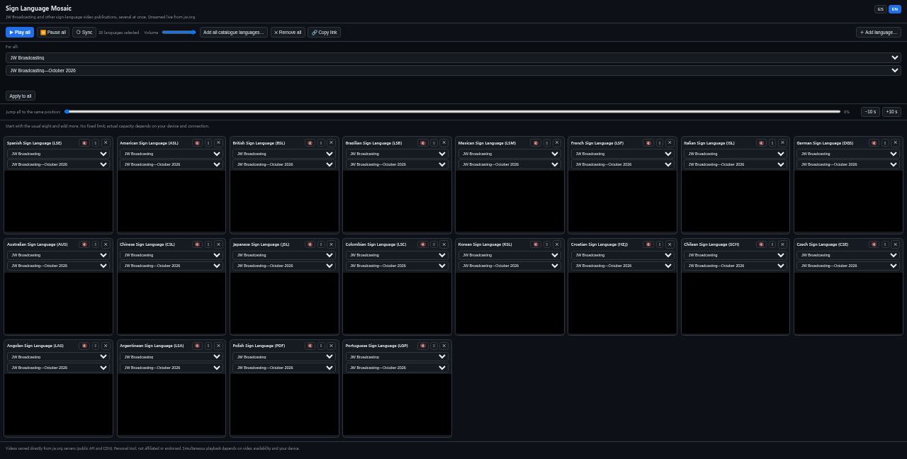

# JW Sign Language Mosaic

Watch the same JW Broadcasting program — or any sign-language video publication from jw.org — in several sign languages at once, side by side, straight from the official jw.org CDN.

**Live demo: https://halcondeoro.github.io/jw-sign-mosaic/**

Twenty sign-language tiles with Psalm 23 selected. Video areas are heavily blurred; no recognizable video content is visible in this image.

## Features

- **All sign languages**: the sign languages returned by the official catalogue API (/languages/E/all), searchable by name or code ("Añadir lengua" panel). The 8 most common ones load by default.
- **Publication picker**: each tile can play any video publication available in that language — Every video-library section offered on jw.org for that language: JW Broadcasting monthly programs plus the library collections (spiritual programs, music, series, children's videos, meetings and ministry, ministry tools, Bible, movies, interviews...), grouped as they appear on jw.org.
- **Books and brochures**: the publication list also includes books and brochures that have video. Every tile loads the same video in its own sign language, found through the pub-media API.
- **Global apply**: pick a collection and program once and apply it to every tile at once (matched across languages by the program's language-agnostic key).
- **Load first, then play**: nothing starts by itself. Every tile (including languages you add later) loads paused and shows its first frame; playback starts only when you press Play all (or Sync), together.
- **Titles in the interface language**: publication lists show English titles with the EN interface and Spanish with ES (from the jw.org English/Spanish listings; items that exist only in sign languages keep the sign-language title).
- **Not available = black cell**: if a language does not have the chosen publication, its cell is black and says so; it never shows a different video.
- **Compare a Bible passage**: in "For all" (or in any tile) choose "Bible: book, chapter and verse", then a book, a chapter and (optionally) a verse. Every tile loads that chapter in its own language and opens paused at that verse; Play all then starts each tile at its verse. Book names follow the interface language. The picker and shared links restore the passage.
- **Chosen verse repeats**: with a verse selected, each playing tile loops that verse (from its verse marker to the next one; the last verse ends with the chapter) instead of running on. "Whole chapter" keeps playing on. Each language has its own markers, so tiles loop independently. Seeking by hand is respected.
- **Strict Bible availability**: a language without the chapter, or without a marker for the chosen verse, shows the black "Not available in this language" cell. It never loads a different passage or the chapter from its start. Verse markers come from the jw.org sign-language Bible (pub-media API); "Whole chapter" does not need them.
- **Synchronized start**: Play all and Sync pause every tile, wait until each can show a frame, seek all to the furthest common timestamp and press play together. Tiles still loading are skipped and reported.
- **One volume control**: a single slider; only one tile has sound at a time (also when you unmute from a tile's own player controls).
- **Shareable link**: "Copy link" gives a URL that opens the mosaic with the same languages, collection and publication.
- **Jump all to the same position**: a slider (same relative position in every video) plus -10 s / +10 s buttons. The jw.org API exposes no chapter or song markers, so jumping is position based.
- **Retry failed**: a button appears when some tiles fail and reloads only those. A retried tile loads paused and joins the next Play all.
- **Tile order**: tiles that load come first, then tiles with a load error, then tiles whose language has no such video. Order inside each group is the order you added them. Tiles are moved, not rebuilt, so playing videos are not interrupted, and a failed tile that loads on retry moves back up.
- **Safe storage**: language, volume and saved selection never break the page if the browser blocks or fills `localStorage`; the app keeps working without saving.
- Per-tile audio toggle, fullscreen, and removal.
- Your selection (languages + collection + program per tile) persists in `localStorage`.
- **Add more languages** individually, or add the available catalogue after confirmation. Bulk additions run one at a time and can be stopped. There is no fixed 16-tile limit. Many simultaneous videos can overload the device or connection; add only what your device handles. The player prefers the 240p MP4 rendition.
- **Keep the chosen program** when adding translations. If a translation is unavailable, the tile says so instead of substituting another program.
- Saved selections are validated and deduplicated on restore. Narrow screens use a single-column layout.

## Tech

Single `index.html`, no build step, no dependencies. Data comes from the public jw.org mediator API (`data.jw-api.org/mediator/v1`); videos stream from the official CDN. No media is downloaded to this repository, rehosted, proxied, cached by this application, or tracked. The browser streams media directly from JW servers. This is a custom HTML video player, not the official JW player or an iframe. Normal browser buffering still occurs.

Use only for personal, noncommercial viewing. [JW terms](https://www.jw.org/en/terms-of-use/) apply. Direct streaming is not presented here as an official embedding authorization. The publishers permit sharing official links and restrict publication of their material on other websites/apps and marketing uses. No media license is granted by this repository.

## Tests

Run `node --test test/*.test.cjs` (Node 22, the version used by CI). The offline tests cover default languages, additions, restoration, input validation, strict program matching, synchronized start, shared volume, share links, retry, tile ordering, storage failures, and the Bible passage picker (strict availability, verse start, verse repeat). They do not prove all catalogue translations exist or that a device can play the entire catalogue at once.

Personal, unaffiliated project. Not endorsed by JW.org or its publishers.

## Terms and takedown

This repository hosts no jw.org media, transcripts or catalogue copies. It contains the page code, its tests and its documentation. Videos and metadata are requested by the visitor's browser from jw.org servers. If the rights holder asks for a change or removal, it will be done promptly: open an issue or contact the repository owner. No third-party logos or brand assets are included.

## Documentation

- [Usage guide](docs/usage-guide.md): every control, step by step.
- [Languages](docs/languages.md): where the catalogue comes from, the default eight, availability rules.
- [Architecture](docs/architecture.md): how the mosaic is built (vanilla JS, no build step).
- [Legal](docs/legal.md): project status, content sources and disclaimers.

## License

MIT — see [LICENSE](LICENSE).
